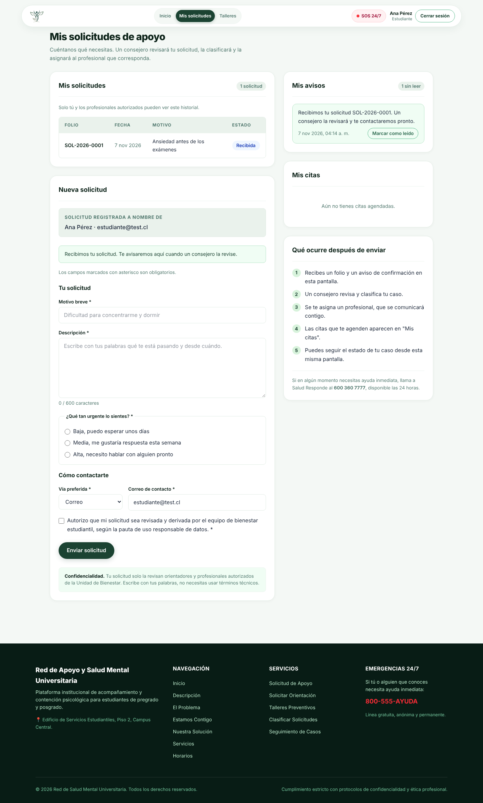
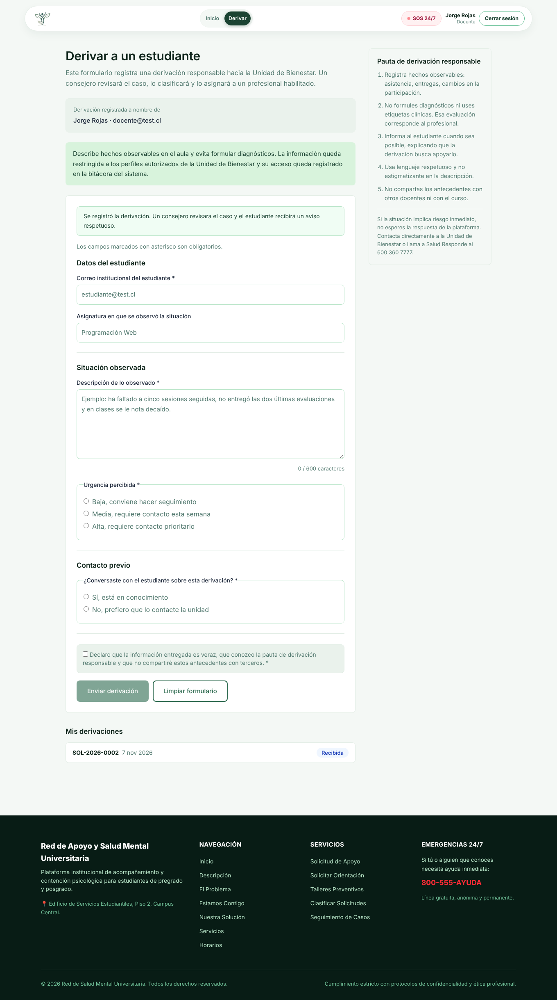
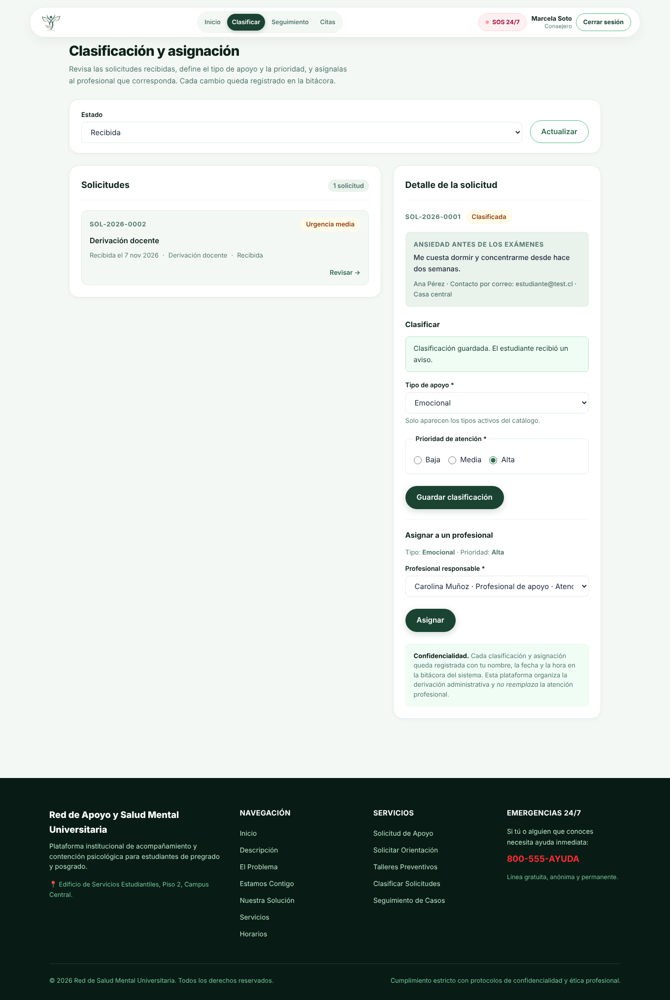
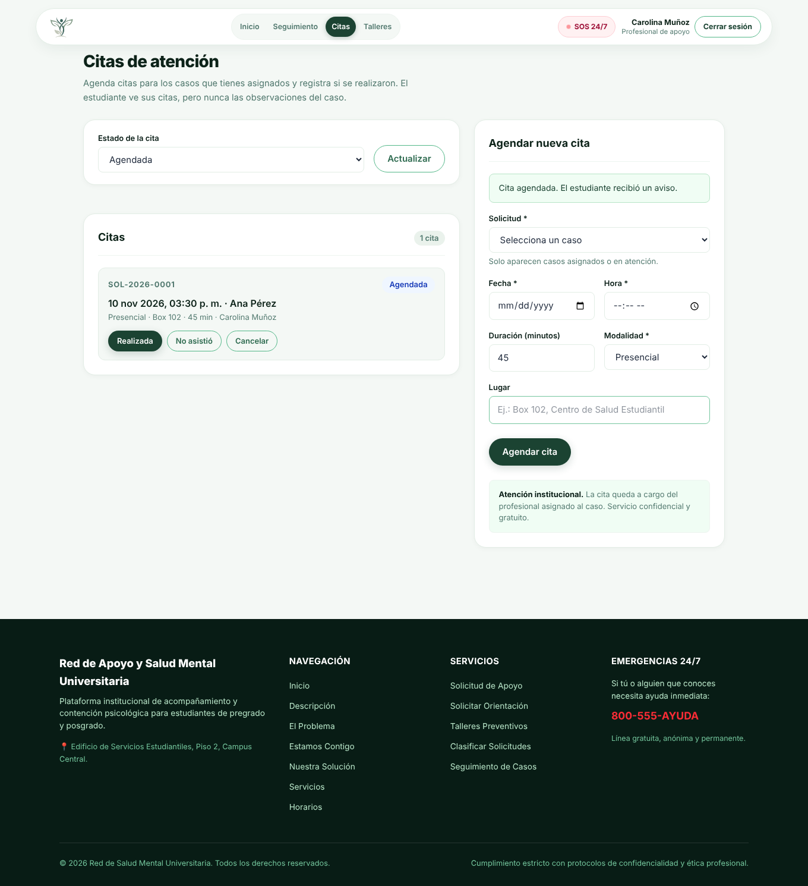
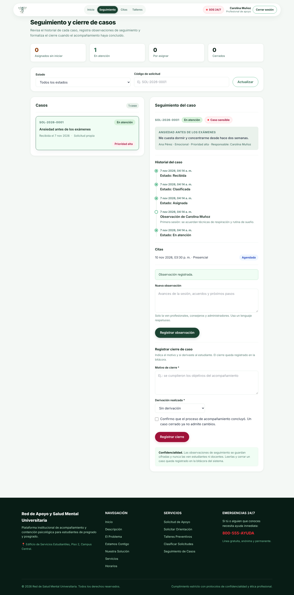
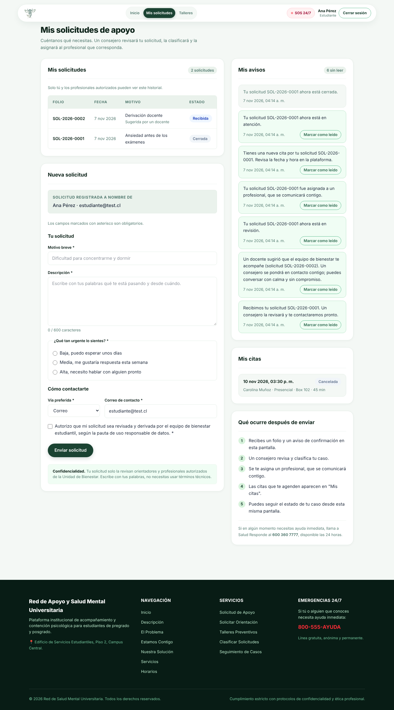
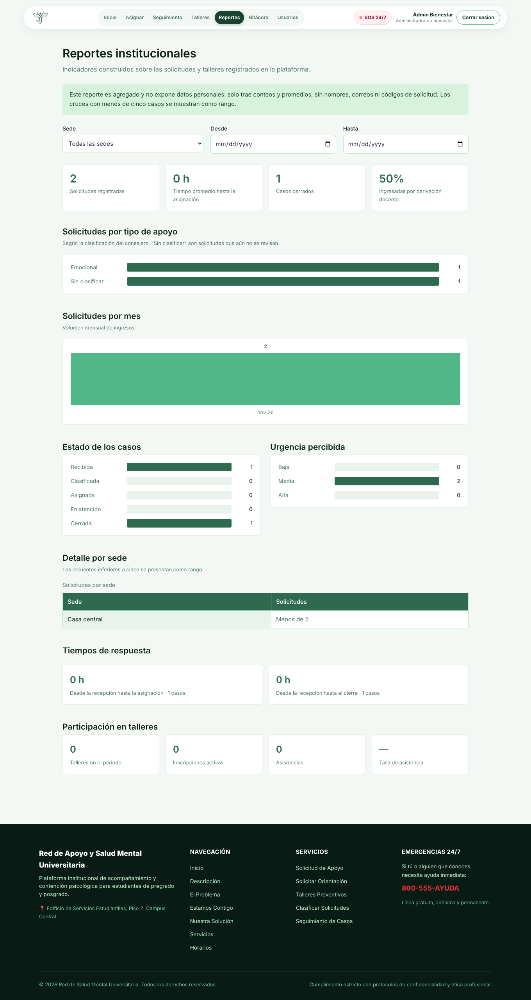
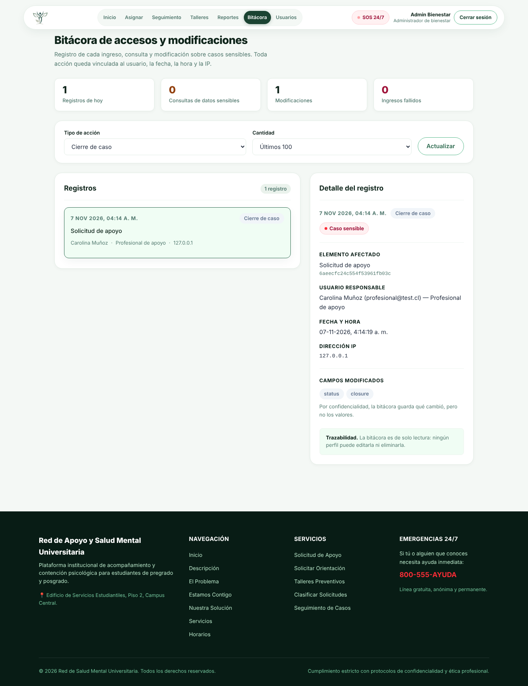
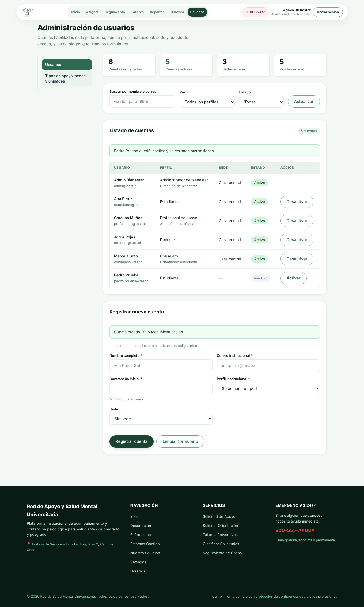
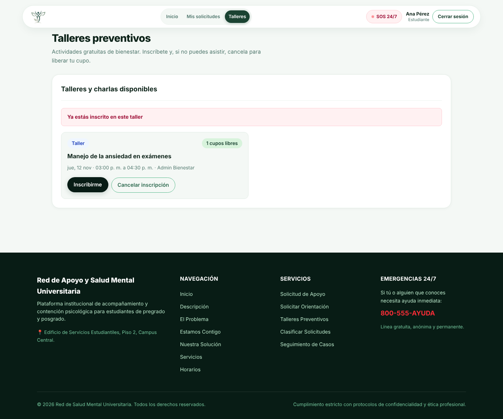

# Red de Apoyo y Salud Mental Universitaria

Plataforma web institucional para registrar solicitudes de apoyo, clasificarlas, asignarlas a profesionales,
agendar atenciones, registrar seguimiento, gestionar talleres preventivos y emitir reportes agregados, con
confidencialidad, control por perfiles y trazabilidad de cada acción.

> La plataforma organiza el acceso, la derivación y el seguimiento administrativo. **No reemplaza la atención
> profesional.** Ante riesgo inmediato: Salud Responde, **600 360 7777** (24 horas).

| Documento | Contenido |
|---|---|
| [docs/API.md](docs/API.md) | Cada endpoint: método, ruta, perfiles, cuerpo y respuestas |
| [docs/GUIA-ADMINISTRATIVA.md](docs/GUIA-ADMINISTRATIVA.md) | Cómo usar la plataforma según el perfil |
| [docs/PAUTA-USO-RESPONSABLE.md](docs/PAUTA-USO-RESPONSABLE.md) | Pauta de uso responsable de los datos |
| [docs/postman/](docs/postman/) | Colección de Postman con todas las rutas y el flujo completo |

---

## Estructura

```
student_mental_healthcare/
├── frontend/      # Librería React + Vite + framework Tailwind CSS
├── backend/       # Node + Express + Mongoose (API REST)
├── docs/          # Documentación, capturas y colección de Postman
└── compose.yaml   # Contenedor de MongoDB
```

La aplicación separa **interfaz** (`frontend/`), **lógica de negocio** (`backend/src/services/`) y **persistencia**
(`backend/src/models/` sobre MongoDB).

## Instalación

Requisitos: **Node.js 22** o superior y **Podman** o **Docker** para MongoDB.

1. **Clonar el repositorio**

   ```bash
   git clone https://github.com/VicDario/student_mental_healthcare.git
   cd student_mental_healthcare
   ```

2. **Levantar MongoDB**

   ```bash
   podman compose up -d     # o: docker compose up -d
   ```

3. **Backend** (http://localhost:3000)

   ```bash
   cd backend
   cp .env.example .env
   npm install
   ```

   Completa en `.env` el `JWT_SECRET` (cualquier texto largo) y la `ENCRYPTION_KEY` (64 caracteres hex):

   ```bash
   node -e "console.log(require('crypto').randomBytes(32).toString('hex'))"
   ```

   Luego carga los datos iniciales y levanta el servidor:

   ```bash
   npm run seed   # borra la base, crea colecciones e índices, catálogos y usuarios de prueba
   npm run dev
   ```

4. **Frontend** (http://localhost:5173), en otra terminal

   ```bash
   cd frontend
   cp .env.example .env      # opcional: VITE_API_URL, por defecto http://localhost:3000/api
   npm install
   npm run dev
   ```

Otros comandos: en el backend `npm run check` (Biome: formato y lint); en el frontend `npm run lint`,
`npm run build` y `npm run preview`.

## Usuarios de prueba

Los crea `npm run seed`. La contraseña de todos es **`123456`**. En la pantalla de inicio de sesión, en «Cuentas de
prueba», se completan con un clic.

| Perfil | Correo | Nombre | Entra a |
|---|---|---|---|
| Estudiante | `estudiante@test.cl` | Ana Pérez | Mis solicitudes, avisos, citas y talleres |
| Docente | `docente@test.cl` | Jorge Rojas | Derivar estudiantes |
| Consejero | `consejero@test.cl` | Marcela Soto | Clasificar, asignar, seguimiento y citas |
| Profesional de apoyo | `profesional@test.cl` | Carolina Muñoz | Seguimiento, citas y talleres |
| Administrador de bienestar | `admin@test.cl` | Admin Bienestar | Asignar, seguimiento, talleres, reportes, bitácora y usuarios |

El seed también carga los catálogos: tipos de apoyo (emocional, académico, social, económico, convivencia y otro), sedes
(Casa central, Sede norte y Sede sur) y unidades de apoyo.

## Flujo principal

```
Estudiante crea solicitud / Docente deriva ─► Recibida
   Consejero clasifica (tipo y prioridad)  ─► Clasificada
   Consejero o admin asigna profesional    ─► Asignada
   Profesional registra seguimiento        ─► En atención   (+ citas)
   Profesional o consejero cierra          ─► Cerrada
```

En cada paso el estudiante recibe un aviso respetuoso, sin datos sensibles, y la acción queda en la bitácora.

| | |
|---|---|
|  **1. El estudiante pide apoyo** |  **o un docente lo deriva** |
|  **2. El consejero clasifica y asigna** |  **3. El profesional agenda citas** |
|  **4. Seguimiento y cierre** |  **5. El estudiante ve sus avisos y citas** |
|  **Reportes agregados** |  **Bitácora** |
|  **Administración de usuarios** |  **Talleres con inscripción** |

Todas las capturas están en [docs/capturas/](docs/capturas/), incluido el aviso de sesión expirada y la vista en celular.

## Seguridad y confidencialidad

- **Contraseñas** con bcrypt. **Sesiones** con JWT y la colección `sessions`: cada petición renueva la sesión, que expira
  tras **30 minutos sin actividad** o al cerrar sesión. El frontend avisa y pide ingresar de nuevo.
- **Mínimo privilegio**: `requireAuth` y `allowRoles` en cada ruta, y `requestScope` decide qué solicitudes ve cada
  perfil (el profesional solo las asignadas, el docente solo sus derivaciones). Fuera de su alcance la API responde
  `404`, para no revelar que el caso existe.
- **Datos cifrados**: la descripción de las solicitudes y las observaciones de seguimiento se guardan con AES-256-GCM
  (`utils/crypto.js`). Si se pierde o cambia `ENCRYPTION_KEY`, esos datos quedan ilegibles.
- **Observaciones de seguimiento**: solo las ven profesionales, consejeros y administradores. Estudiantes y docentes
  reciben `403`.
- **Bitácora** de ingresos, ingresos fallidos, consultas de datos sensibles y modificaciones, con usuario, perfil,
  fecha e IP. Guarda qué campos cambiaron, nunca sus valores, y es de solo lectura.
- **Reportes agregados**: solo conteos y promedios. El frontend muestra como rango los cruces con menos de cinco casos.
- **Validación** con Zod en cada ruta, con mensajes en español y el mismo formato de error en toda la API:
  `{ message, errors: [{ field, message }] }`. Los errores internos nunca muestran detalles técnicos.

## Backend

```
backend/src/
├── config/        # Conexión a MongoDB y constantes (perfiles, estados, tipos)
├── models/        # 10 colecciones de Mongoose
├── routes/        # Rutas y perfiles permitidos en cada una
├── controllers/   # Reciben la petición y responden
├── services/      # Lógica de negocio y acceso a datos
├── middlewares/   # Sesión y perfiles, validación y manejo de errores
├── schemas/       # Esquemas de Zod de cada endpoint
├── utils/         # JWT, cifrado y errores HTTP
├── app.js · server.js · seed.js
```

Colecciones: `users`, `sessions`, `catalogs`, `supportRequests`, `followUps`, `appointments`, `notifications`,
`workshops`, `enrollments` y `auditLogs`.

Para proteger una ruta: `requireAuth` exige sesión y deja `req.user = { id, role }`; `allowRoles(...)` limita por
perfil. Los servicios lanzan `HttpError(status, message, errors?)` y `errorHandler` responde con el formato común.

```js
router.patch('/:id/assign', allowRoles('counselor', 'admin'), validate(assignRequestSchema), assignRequest)
```

## Frontend

```
frontend/src/
├── api/client.js        # Llamadas a la API: token, errores y aviso de sesión expirada
├── auth/                # Sesión (AuthProvider), rutas protegidas (RequireRole) y menú por perfil
├── hooks/               # useApi (cargar datos) y useSubmit (enviar formularios)
├── components/
│   ├── ui/              # Componentes reutilizables (Panel, Button, Badge, FormField, ApiMessage…)
│   ├── layout/          # Navbar, Footer, DashboardPage
│   └── <módulo>/        # solicitud, derivacion, clasificacion, seguimiento, talleres, reportes, bitacora, admin-usuarios
├── pages/               # Una página por ruta
└── utils/               # Textos en lenguaje claro para los valores de la API
```

| Pantalla | Ruta | Perfiles |
|---|---|---|
| Inicio | `/` | Público |
| Iniciar sesión | `/login` | Público |
| Mis solicitudes, avisos y citas | `/solicitud-apoyo` | Estudiante |
| Talleres (inscripción) | `/talleres` | Estudiante |
| Derivar estudiante | `/derivacion-docente` | Docente |
| Clasificar y asignar | `/clasificacion` | Consejero, administrador |
| Seguimiento y cierre | `/seguimiento` | Profesional, consejero, administrador |
| Citas | `/agendar-cita` | Profesional, consejero |
| Gestión de talleres | `/gestionar-talleres` | Administrador, profesional |
| Reportes | `/reportes` | Administrador |
| Bitácora | `/bitacora` | Administrador |
| Usuarios y catálogos | `/admin-usuarios` | Administrador |

El diseño es responsive (sin desplazamiento horizontal en celulares) y los formularios muestran bajo cada campo el
mensaje de validación que entrega la API.

## Pruebas

- **Postman**: importa [`docs/postman/salud-mental.postman_collection.json`](docs/postman/), con `npm run seed` y el
  backend corriendo. Corre las carpetas en orden: primero «0. Iniciar sesión». Cada consulta revisa sola su resultado.
- **Flujo end-to-end**: el recorrido de las capturas (solicitud → derivación → clasificación → asignación → cita →
  seguimiento → cierre → avisos → reportes, bitácora y usuarios) se verificó en el navegador.

## Equipo

Grupo 5 — Desarrollo Web y Móvil: Victor Fernández, Fabián Guzmán, Benjamín Zúñiga y Eliezer Patiño.
